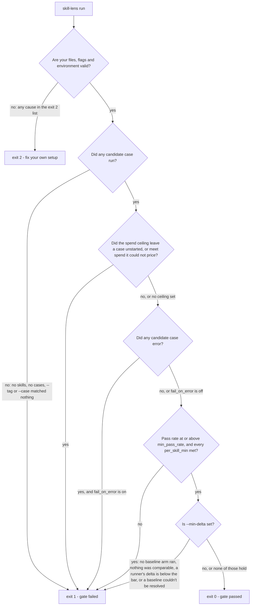

# Gating and exit codes

Exit codes are the CI contract. This page is where they are defined; every other page
summarises them and links here.

| Code | Meaning |
| --- | --- |
| `0` | Gate passed |
| `1` | Gate failed — including a run in which [no case ran at all](troubleshooting.md#no-eval-cases-ran) |
| `2` | User or authoring error — something in your files, flags or environment is wrong, so nothing was measured. [Every cause is listed below](#exit-2-user-and-authoring-errors). |



## Exit 2: user and authoring errors

Exit `2` is deliberately not a gate failure. A mistake in your setup says nothing about the
skill, so the run stops instead of scoring it as evidence against the skill (see
[Authoring errors abort the run; they never score as failures](invariants.md#authoring-errors-abort-the-run-they-never-score-as-failures)).
Every cause below is found **before any case runs**, so it spends no money — except two. A
malformed regex is found when its assertion runs, so earlier cases may already have spent
money. A report that cannot be written is found after the run.

This list is complete. It follows `_AUTHORING_ERRORS` and the `typer.BadParameter` checks in
`src/skill_lens/cli.py`; a new exit-2 cause is added here, and only here.

**A flag, or a flag combination, that cannot work.**

- An unknown `--runner`, or the same runner named twice (on the flag or in
  `default_runner`); an unknown `--baseline`; an unknown `judge` in `skill-lens.toml`.
- `--repeat`, `--concurrency` or `--markdown-max-chars` below `1`, or
  `--markdown-max-chars` without `--markdown-output`.
- `--min-delta` without `--baseline` (see [below](#gating-on-the-delta-min-delta)).
- A `--max-spend` that is not a positive, finite amount (`0`, negative, `inf`, `nan`).
- A `--model` or `--judge-model` that resolves to blank, or an invalid `--base-url`.
- A `--model`, `--base-url` or `--judge-model` that nothing in the run reads (see
  [CLI](cli.md#run)).

**A `skill-lens.toml` that cannot be used** (`ConfigError`): a `--config` path that does not
exist, invalid TOML, an unknown key, an invalid value (such as a `base_url` holding a
credential, or an empty `default_runner`), or a `cli` runner or judge with no
`[runners.cli] command`. See [Configuration](configuration.md).

**A skill that cannot be read** (`SkillParseError`): a path that does not exist, an
unreadable `SKILL.md`, malformed frontmatter, a `version:` that YAML does not read as text
(see [the invariant](invariants.md#a-version-that-yaml-does-not-parse-as-a-string-is-an-authoring-error)),
or two skills with one name (see [Names are unique](eval-files.md#names-are-unique)).

**An eval file that cannot be used** (`CaseParseError`), including a tool library it
imports: malformed YAML, an unknown key, an unknown assertion `kind:`, a leftover
`TODO(skill-lens)`, `file:` or
`judge.artifacts` without a `workspace:` block, a rubric entry phrased against a mock
tool's `returns:`, an invalid `input_schema`, a `when:` entry that could never answer a
call, a `ref:` that cannot be resolved, or two cases of one skill with one name. See
[Eval files](eval-files.md).

**An assertion that cannot be checked** (`InvalidAssertionValue`): a malformed regex. It is
found when the assertion runs, not when the file loads, so `skill-lens list` does not catch
it. (`UnknownAssertionKind` is the same check for a case built in code, which skips the
loader.)

**A runner or judge that cannot run here**, found in preflight (the checks made after
loading and before the first case):

- A keyed runner or judge whose provider key is not exported (`MissingAPIKey`).
- A runner whose optional dependency is not installed (`RunnerDependencyError`).
- A `trajectory:` naming a tool the case does not declare under `fake`, `pydantic-ai` or
  `langchain` (`UndeclaredTool`; a product's tool names are not checked — see
  [Declaring tools](runners.md#declaring-tools-and-scoring-the-trajectory)).
- A `base_url` for a provider that takes no endpoint (`UnsupportedBaseURL`).
- A [product runner](runners.md#product-runners) or
  [product judge](runners.md#judging-with-a-product) that cannot run here
  (`ProductSetupError`): its executable not on `PATH`, a preset's `--version` failing, a
  skill name that cannot be a directory name, a case with `tools:` under a product that
  cannot take the [MCP bridge](runners.md#mock-tools-under-a-product), `trajectory:` or
  `mode: offered` under `cli`, the bridge failing its start-up check, `--available-tools`
  in `[runners.copilot]` while a case declares `tools:`, or a tool-selection flag in a
  product judge's `args`.

**A spend ceiling that could never be enforced** (`SpendCeilingError`): `max_spend_usd` or
`--max-spend` set for a run with a runner or judge whose spend is never priced in US dollars
— `copilot`, `cli`, or a keyed runner or judge whose model has no price. See
[The spend ceiling](#the-spend-ceiling).

**Bundled scripts turned on but unable to run** (`ScriptSetupError`): a script's
interpreter is not on `PATH`, or `script_sandbox = "required"` and no sandbox backend works.
See [Security](security.md).

**A report that cannot be written.** A `--json-output`, `--junit-output` or
`--markdown-output` file that cannot be written exits `2` — but only when the gate itself
passed. A failing gate stays `1`, so a write problem never hides a red run.

The other commands use the same code for the same kind of problem: `list` exits `2` on a
skill or eval file that cannot be read, `init` on a file it cannot read or write, and
`mcp-import` on a listing it cannot read or parse.

When a message on your screen is not explained here, [Troubleshooting](troubleshooting.md)
is keyed by the exact text a run prints — search it for the words you see.

A run fails the gate when the overall pass rate is below `min_pass_rate`, when a configured
per-skill minimum is not met, or when any case **errored**. Two distinctions matter:

- **failed** — the case ran and scored below the bar. An *eval* signal.
- **errored** — something in the harness blew up rather than the skill scoring badly: the
  runner (API error, timeout; a product that exited non-zero, timed out, or
  reported its own failure), or an evaluator (a judge endpoint returning 500,
  a judge verdict that does not match its rubric, a product judge whose reply holds no
  readable verdict, an offered case on a runner that does not support the mode). An *infra*
  signal, and it fails the gate by default so CI never goes green on a broken run.

A case that fails its assertions drags the pass rate below the bar and fails the gate:

```
[FAIL] badskill :: expects something absent (fake)
        assertion: failed: contains('NEVER_PRESENT'): did not hold

0 passed, 1 failed, 0 errored — pass rate 0%

Gate FAILED:
  - pass rate 0% is below the required 100%
```

**A run that executed zero cases also fails.** "Nothing ran" is a broken run, not a pass —
otherwise a mistyped path reports success forever. The reason names the cause: no skills found,
all skills skipped for having no eval cases, every case filtered out by `--tag`, or no case name
matching `--case`.

```
Skipped (no eval cases): badskill

0 passed, 0 failed, 0 errored — pass rate 0%

Gate FAILED:
  - no eval cases ran: all discovered skill(s) were skipped for having no eval cases: badskill
```

**Every gate rule above reads the candidate arm only.** Under `--baseline`, a run also
produces baseline outcomes, but `min_pass_rate`, `per_skill_min`, `fail_on_error` and the
zero-cases check never see them — a strong baseline means the skill was unnecessary, not that
CI should go red. With no baseline, candidate and baseline are the same (empty) set, so none
of these numbers move from what they were before comparative evals existed.

## The spend ceiling

`max_spend_usd` in `skill-lens.toml`, or `--max-spend` for one run, caps what a run spends,
in US dollars. It counts everything the run records: each outcome's `cost_usd`, the
`retry_cost_usd` of the attempts a retry discarded, and every evaluator's cost (the judge's),
from both arms, errored runs included — an errored product run keeps the cost its trace
reported, and an errored `pydantic-ai` or `langchain` run keeps the cost of the responses it
received.

Before each case starts, skill-lens compares the spend recorded so far with the ceiling.
Once it has *reached* the ceiling, no new case starts. A case that is already running is
never interrupted: it finishes, is scored, and its spend is added. So the ceiling bounds when
new work starts, not the total — a run can end above it by what was in flight when it was
crossed: at most the one case that crossed it at `--concurrency 1`, and at most
`--concurrency` cases above that. The first case always starts.

Every case the ceiling kept from starting is reported as **not run**, in the order it would
have run. A not-run case is not `failed` and not `errored` — it has no result to judge — so
it is listed apart from the outcomes and counted in none of `passed`, `failed`, `errored` or
the pass rate, which describe the cases that ran. Instead, **any not-run case fails the
gate**, of either arm, whatever `min_pass_rate`, `per_skill_min` and `fail_on_error` say: the
run measured less than it was asked to. The summary line counts the candidate arm, as it does
for everything else; the gate reason counts both arms, and says how they split when a
baseline run was among them (`4 cases did not run (2 candidate, 2 baseline)`). A ceiling crossed by the very last case left nothing
unstarted, and does not fail the gate.

```
[PASS] pdf :: extracts the title (pydantic-ai)
[PASS] pdf :: keeps the tables (pydantic-ai)

Not run (stopped by the spend ceiling):
  pdf :: handles a scanned page (pydantic-ai)

2 passed, 0 failed, 0 errored, 1 not run — pass rate 100%
Total cost: $0.5300 | Spend ceiling: $0.50 ($0.5300 recorded)

Gate FAILED:
  - 1 case did not run: the spend ceiling of $0.50 was reached ($0.5300 recorded)
```

A ceiling cannot be enforced against spend it cannot see, so a run whose spend is known to be
unpriceable is refused before anything is spent (exit `2`): a `copilot` runner or judge, which
bills per premium request rather than in dollars, a `cli` one, which reports no cost, and a
keyed runner or judge whose configured model `genai-prices` has no price for. Leave the
ceiling unset for those runs.

The rest is caught as it happens. An outcome whose cost — the run's or the judge's — could
not be priced carries a `cost_note` and a `cost_usd` of `0.0`, and that zero is not free:
the model the provider served had no price, a provider reported no token usage, or a
`claude-code` run ended before it reported its cost. So once any outcome's spend is unpriced,
the run stops starting new cases as if the ceiling were reached, and the gate fails with a
reason naming the first such outcome and its note, even if nothing was left unstarted.

Under `--baseline`, a case that lost any repetition of either arm to the ceiling is excluded
from the delta, both arms together, with the exclusion reason saying so: a delta over the
half that ran would be an unmeasured comparison.

## More than one runner

When a run names several runners, every candidate `(skill, case, runner)` outcome counts
toward the pass rate: a case that fails under one framework fails the gate, whatever it
did under the other. `per_skill_min` is per skill across runners. `--min-delta` is the one
rule applied per runner: every runner's own pass-rate delta must meet it (see below). There
is no per-runner `min_pass_rate`.

## Gating on the delta (`--min-delta`)

`--min-delta <float>` adds four more gate rules, all evaluated against the
[delta](comparative-evals.md#the-delta-block) between the candidate and baseline arms:

- **no baseline arm ran at all** — every case's baseline was skipped (for example, an
  all-`offered` suite under `--baseline none`), so there is nothing to build a delta from in
  the first place;
- **no case was comparable** — a delta gate that verified nothing must never report a pass,
  the same principle that fails a run executing zero cases. With more than one runner, a
  runner with no comparable case fails this rule on its own, named;
- the pass-rate delta is below `min_delta` — with more than one runner, **any runner's**
  pass-rate delta, each named, because an aggregate across runners lets one that improved
  hide one that regressed;
- a skill's baseline **could not be resolved** — named, with the reason — because treating an
  unresolvable baseline as "no change" would let a repository pass this gate forever by
  deleting its git history.

`--min-delta` requires `--baseline`; passing one without the other is a user/authoring error
(exit `2`), not a gate failure, since the configuration is rejected before any case runs. A
deliberately skipped baseline (an `offered` case under `--baseline none`) is not, on its own,
a gate reason — nothing went wrong there. But that is only true for *some* cases skipping
their baseline: if *every* case's baseline is skipped this way, there is no baseline arm left
to compare against, and the first rule above fires instead. See
[Comparative evals](comparative-evals.md#-min-delta) for the full picture, including how the
delta is paired and what makes a case comparable.

**Low-signal checks and high-variance cases are advisory.** They are printed alongside a
comparative run's output to point at weak spots in the eval suite, but they never affect the
exit code — see
[Low-signal checks and high-variance cases](comparative-evals.md#low-signal-checks-and-high-variance-cases).

## What a failing case shows

A case that did not pass shows *why* in every reporter: each failing evaluator's detail and
each failing judge check's evidence, and then what the agent actually did — its output and
every tool call, in order.

```
[FAIL] order-support :: refuses a refund outside the return window (pydantic-ai)
        assertion: failed: contains('1234'): did not hold
            contains[0]: contains('1234') did not hold
        output: I'm sorry, but that order was delivered 45 days ago, so it is
        outside our 30-day return window and I can't refund it.
        tool calls:
            lookup_order(order_id="1234")
```

The output is cut at 500 characters. A cut is never silent — the line `… (1,842 more
characters; --full-output prints them)` states exactly how much was removed — and an empty
output prints `output: (empty)`, because "the agent said nothing" is the single most useful
fact about a failed assertion. Tool-call argument values are cut at 80 characters and the
list at 20 calls, with a `… +N more calls` count. `--full-output` (or `full_output = true` in
[`skill-lens.toml`](configuration.md)) lifts the output cap.

Under the `claude-code` runner, a skill's [hooks](runners.md#hooks-under-claude-code) that did
not report `success` follow, under `failed hooks:` — each with its outcome, its exit code
when it had one, and its stderr then its stdout, each on one line. A stream is cut at 200
characters, never silently — the cut states the count, as the output's does — and
`--full-output` lifts that cap too:

```
        failed hooks:
            PostToolUse:Write error (exit code 127): stderr="check-complete.sh: line 4: jq: command not found"
```

The list stops at 10, with a `… +N more failed hooks` count; a hook that succeeded is not
listed. The JSON report's `hooks` keeps every hook in full.

Only **non-passing candidate** outcomes are expanded. Passing cases stay one line, and
baseline outcomes are never expanded — they are not the verdict; the delta block is. The
Markdown report renders the same excerpt in fenced blocks inside its failures section, and
the JUnit report appends it to the `<failure>` or `<error>` body. All three read one shared
excerpt, so they can never disagree on what was shown.

## JSON report

`--json-output report.json` writes a machine-readable report alongside the console output:
a `summary` block (counts, overall and per-skill pass rates, token/cost/latency totals),
`skipped_skills`, `tag_filtered_skills`, `case_filtered_skills`, a per-case `outcomes` list,
a top-level `delta` block, `baseline_notes`, `scripts` (`null` when script execution was
off, else `{sandbox, detail, hardening}` saying which OS sandbox the run's scripts ran under
and why — `sandbox` is `"sandbox-exec"`, `"bwrap"` or `"none"` — and whether the harness
could hide its own environment from same-user processes: `hardening` is a short note on
Linux when `prctl(PR_SET_DUMPABLE, 0)` applied, else `null`), `script_notes` (skills that bundle
scripts while skill-lens's `run_script` was off, each as `{skill_name, script_count,
product_note}`; `product_note` is the fixed sentence that product runners can still run the
scripts through their own tools when the run includes a product runner, else `""`),
`products` (one entry per product the run executed, as a runner or as the judge — a product
serving as both is listed once — each as `{name, executable, version, trust, sandbox}`;
`trust` is the fixed sentence about permission prompts and what the run's product sandbox
applied, the same one the console prints, describing the product's runner trust whichever
seat it filled — a judge-only product delivers no skill, so it has no bundle for that
sentence's reachable-scripts clause to reach; `sandbox` is the same decision as data,
`{mode, backend, home_isolated, detail}` — `mode` is `product_sandbox` (`auto`, `required`
or `off`), `backend` is `sandbox-exec`, `bwrap` or `none`, `home_isolated` is true under
`auto` and `required` (a temporary home and an allowlisted environment, which is not a
sandbox on its own), and `detail` is the probe's reason, such as `bwrap not found on PATH`;
see [Runners](runners.md#product-runners); empty when no product ran), and the `gate`
decision with its reasons.

The spend ceiling adds three fields. `not_run` lists every case the ceiling kept from
starting, in the order it would have run, each as `{skill_name, case_name, runner, arm,
repeat_index}`; none of them is in `outcomes`. `summary.not_run` counts the candidate-arm
ones, like every other count in `summary`. `spend_ceiling` is `null` when no ceiling was set,
else `{max_spend_usd, spent_usd, unpriced}`: `spent_usd` is everything the run recorded
spending (`summary.total_cost_usd` plus `summary.judge_cost_usd`), and `unpriced` names the
first outcome whose spend could not be priced, with its note, or is `""`. See
[The spend ceiling](#the-spend-ceiling).

Comparative evals changed this document additively, not by rewriting what was already there:
every field that existed before them still means what it meant, and the comparison adds
fields alongside them — `arm` and `repeat_index` on each outcome, `baseline_errored` in
`summary`, and the top-level `delta` (`null` when no baseline arm ran) and `baseline_notes`.
A tool that reads only the older fields keeps working unmodified.

Each entry in `outcomes` carries `arm` (`"candidate"` or `"baseline"`) and `repeat_index`
(0-based), so a comparative run's raw per-repetition results can be reconstructed from the
JSON even though the console collapses them to one line per case.

`outcomes[].workspace` is that case's temporary directory path when
[`--keep-workspace`](cli.md) kept it, `null` otherwise — including for every case that
declared no `workspace:` block at all. It is never a path to a directory that has already
been deleted: the field is cleared at the same moment the directory is, so it can never be
a stale pointer in the report.

`outcomes[].stop_note` is set when the run's framework stopped it at the case's `max_tokens`
before the agent finished (see
[Stopping a runaway case](runners.md#stopping-a-runaway-case)), and is `""` for a run that
finished. `outcomes[].retry_cost_usd` is what the attempts a retry discarded cost; every
other figure on the outcome is the attempt that produced it.

`outcomes[].hooks` lists every lifecycle hook the run reported, in order, each as `{name,
event, outcome, exit_code, stdout, stderr}` — `exit_code` is `null` when the hook had none.
Only a `claude-code` run reports hooks, and an errored one only when its trace reached its
`result` event (see [Hooks under Claude Code](runners.md#hooks-under-claude-code)); every
other outcome has `[]`. No check reads them,
so they never change a status or the exit code.

`outcomes[].cost_note` and `outcomes[].usage_note` say why `cost_usd` or a token count is
`0` rather than measured — an unpriced model, a product that bills per request rather than
per token, a trace that reported no usage or no cost, or a product run that ended before
reporting what it spent (a timeout, a cut trace, no `result` event: `claude-code timed out
before reporting cost`) — each empty string when the figure beside it is a real
measurement. An errored product outcome keeps the notes its trace reported, as it keeps the
figures (below): an errored Copilot run carries Copilot's premium-request `cost_note` like a
clean one. A run that ended before reporting its spend is errored too, and its note is there
so a run that may have spent money is not read as free; `summary.total_cost_usd` is then a
lower bound. Either way the console and Markdown totals say some costs were not priced. An
errored outcome that never started a process has empty notes, because its `0` is a
measurement.

`outcomes[].scores[].cost_note` does the same for an evaluator's own spend, which is
`summary.judge_cost_usd` — today the judge's: an unpriced judge model, a product judge that
bills per request, or a judge run that ended before reporting its cost. Any such note makes
the totals line say `Judge overhead: not priced` or `some judge costs not priced`, apart
from the run's own cost line.

`delta` is the full comparison object — pass-rate, token, cost and latency deltas, per-case
stats, low-signal checks, high-variance cases and notes — and is `null` when no baseline arm
ran. Its top-level deltas aggregate every runner; `delta.runners` has the same deltas for each
runner, with `comparable_cases`, and is what `--min-delta` reads when there is more than one.
Every `delta.low_signal[]` and `delta.high_variance[]` entry names its `runner`, so one case
flagged under two runners appears once per runner. `baseline_notes` lists why a skill's or
case's baseline was skipped or unavailable.
`summary.baseline_errored` counts errored baseline repetitions apart from `summary.errored`,
which is candidate-only, for the same reason the gate itself only reads the candidate arm
(above): an errored baseline invalidates that case's delta, it does not mean the skill broke.

`summary`'s token, cost and latency totals sum **both** arms — money spent is money spent —
while `summary.passed` / `summary.failed` / `summary.errored` / `summary.pass_rate` stay
candidate-only, because those are what the gate reads. For the same reason the totals include
errored outcomes: an errored product run keeps the tokens and cost its trace reported (a
Claude Code run stopped by `--max-budget-usd`, say), so its `outcomes[]` figures can be
non-zero. They only add to the totals; the outcome is still `errored`, and no check reads it.

## JUnit XML

`--junit-output` writes a JUnit report, the format GitHub, GitLab, Jenkins, CircleCI and
Buildkite all ingest natively.

| skill-lens | JUnit |
| --- | --- |
| `passed` | `<testcase>` with no child |
| `failed` | `<testcase>` with `<failure>` |
| `errored` | `<testcase>` with `<error>` |
| a skill with no cases | `<testcase>` with `<skipped>` |
| a candidate case the spend ceiling kept from starting | `<testcase>` with `<skipped>` |

The `failed`/`errored` split is the same one the exit code and the JSON report use: a
`<failure>` means the case ran and scored below bar, an `<error>` means the runner or an
evaluator blew up.

Only the **candidate** arm becomes test cases. Under `--baseline`, a failing baseline is the
evidence that the skill helped, so rendering it as a `<failure>` would turn CI red for the
skill working.

A run with no eval cases emits a single `<testcase>` carrying an `<error>` that repeats the
gate's reasons. An empty `tests="0"` file renders green in most CI UIs, which would contradict
the exit code of 1.

For the same reason, a run the [spend ceiling](#the-spend-ceiling) failed gets one more
`<testcase name="spend ceiling">`, in a suite named `skill-lens`, carrying an `<error>` with
the gate's ceiling reasons. Otherwise a run whose every case that ran passed would render as
green and skipped against exit code 1.

When scripts were enabled, every `<testsuite>` — a skill that ran, a skipped or filtered
skill, and the synthetic zero-case error suite alike — carries `<properties>` as its first
child, with `skill-lens.scripts.sandbox` and `skill-lens.scripts.detail`: properties are
where JUnit puts run-level facts, and a testcase is the wrong place for something true of
the whole run. The console and Markdown reports print the same fact as one line (`scripts: on,
sandbox: <backend>` on the console, with the probe's detail in parentheses when the backend
is `none`, and `; <hardening note>` appended when the harness could hide its own
environment — see [Runners](runners.md#running-bundled-scripts)) and name every skill whose
bundled scripts did not run because execution was off.

When a product ran — as a runner or as the judge — the same `<properties>` element carries
`skill-lens.products` on every suite: one value naming each product, its version, its
executable and its trust sentence, joined with `; `. The console prints the same fact as one
`product <name> <version> (<executable>): <trust>` line per product, and the Markdown
summary as a footnote; see [Runners](runners.md#product-runners).
